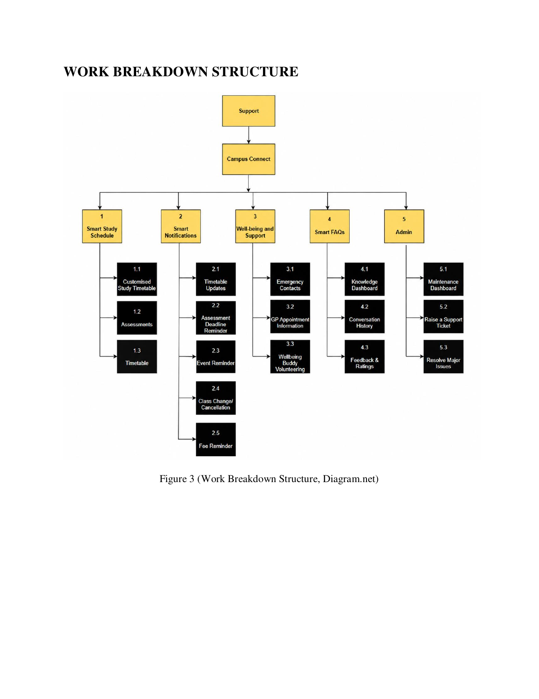
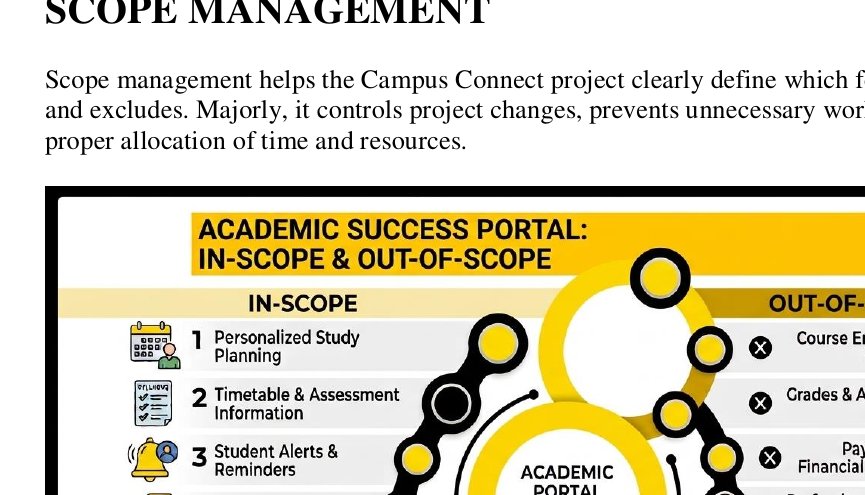
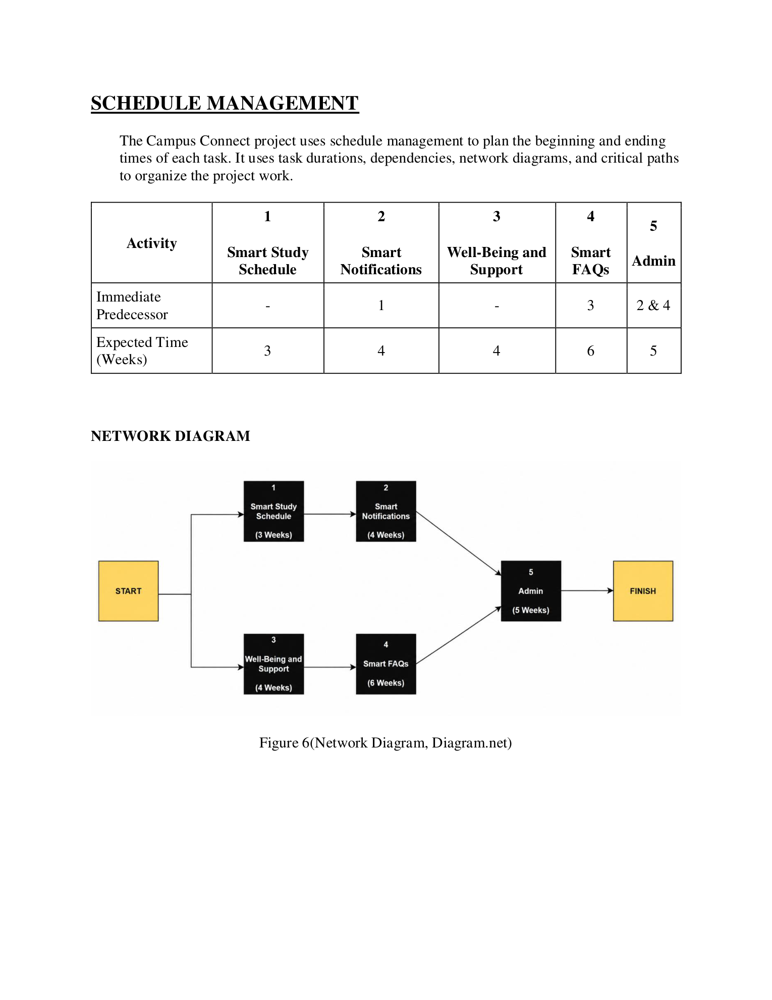
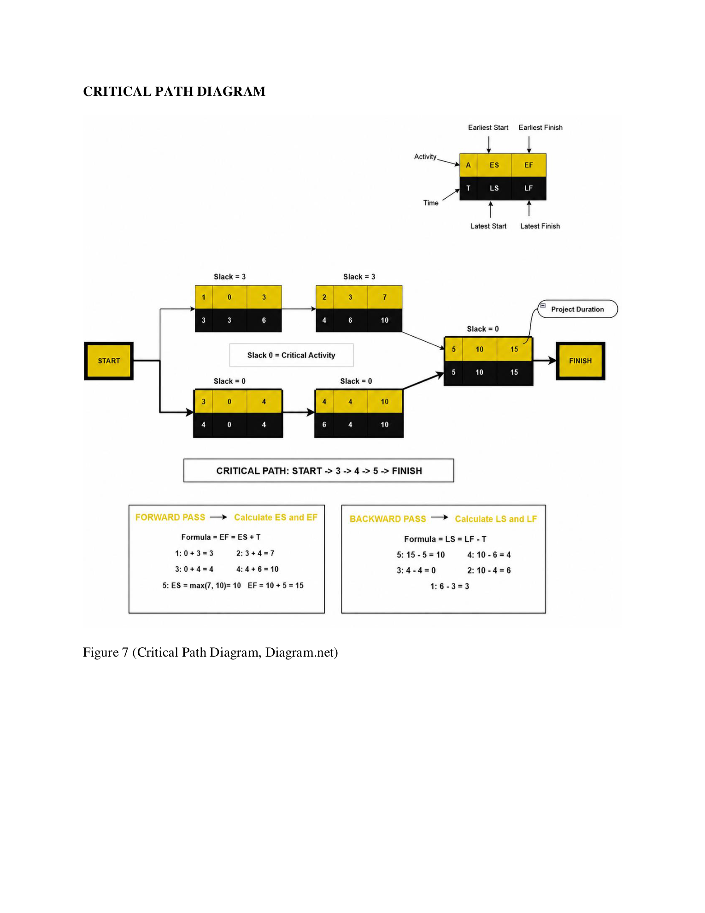
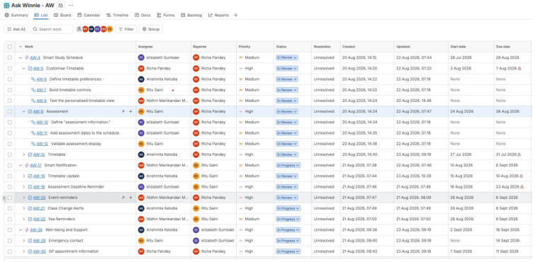

# IT Project Management Methodology Analysis

## Project Overview

This repository presents academic IT project work completed as part of university group projects.

The work explored two related project scenarios:

1. **Project 1 — Campus Connect / Ask Winnie:** A proposed IT project designed as an additional feature within the university's Moodle environment.
2. **Project 2 — IT Project Methodology Analysis:** An analysis of an existing IT project and the selection of an appropriate project management methodology.

The projects focused on project management methodologies, methodology selection, risk management, leadership, stakeholder involvement, and project delivery.

---

## Project 1 — Campus Connect / Ask Winnie

For the first project, our group developed a proposed IT solution called **Campus Connect**, designed as an additional feature within the university's Moodle environment.

The proposed solution included:

* Smart Study Schedule
* Smart Notifications
* Wellbeing and Support
* Smart FAQs
* Administrative functionality
* An interactive chatbot called **Ask Winnie**

The project was developed around the idea of making important information and student support easier to access in one place.

### Project Objectives

The proposed project aimed to:

* Help new students settle into university
* Help students organise their study time
* Help students track assignment deadlines
* Provide useful notifications
* Make wellbeing information and support easier to access
* Help students find appropriate support and guidance

---

## Project 2 — IT Project Methodology Analysis

The second project involved analysing an existing IT project and recommending an appropriate project management methodology.

Our group examined the **Spiral Methodology** and considered why it was appropriate for the project.

The analysis focused on:

* Risk management
* Changing requirements
* Continuous user involvement and feedback
* Iterative testing
* Software quality
* Technical and stakeholder collaboration
* Privacy and ethical risks

The Spiral approach was considered suitable because it allows a project to progress through repeated cycles of planning, risk assessment, development, and evaluation.

---

## Methodology Analysis

### Spiral Methodology

The Spiral Methodology was analysed as a risk-focused and iterative approach.

### Risk Management

Potential risks can be identified and addressed early before significant time and resources are committed.

### Changing Requirements

The approach allows requirements to be refined as the project's needs become clearer.

### Continuous User Feedback

Early versions and prototypes can be tested and reviewed so that user and stakeholder feedback can inform later development cycles.

### Iterative Testing

Problems identified during one development cycle can be corrected and tested again before progressing to the next cycle.

### Stakeholder Collaboration

Different professionals and stakeholders can contribute their perspectives when reviewing progress, risks, priorities, and technical considerations.

### Privacy and Ethics

Privacy, security, data accuracy, and ethical considerations can be assessed throughout the project.

---

## Leadership Analysis

The second project also examined leadership requirements for working effectively within the project environment.

### Leadership Model

**Traits-Based Leadership Model**

### Leadership Style

**Transformational Leadership**

Important leadership qualities identified included:

* Risk management and analytical thinking
* Communication and stakeholder engagement
* Adaptability and flexibility
* Decision-making and problem-solving
* Collaboration and team leadership
* Planning and resource management
* Commitment to quality, ethics, and accountability

---

## Project Artefacts

The following artefacts demonstrate the planning and project-management work completed for the Campus Connect project.

### Work Breakdown Structure

The Work Breakdown Structure shows how the proposed project was divided into major work areas and activities.

### Scope Diagram

The scope diagram identifies the proposed features included within the project and the features that were outside the project scope.

### Network Diagram

The network diagram demonstrates project activities and their dependencies.

### Critical Path

The critical-path analysis demonstrates how project activities were sequenced and identifies activities that affected the overall project schedule.

### Jira Project Board

The Jira evidence demonstrates the use of project-management tools for task tracking, priorities, status monitoring, and project progress.

---

## My Contribution

This work was completed as part of university group projects, and the projects were completed collaboratively.

My individual contribution focused particularly on **Project 2 — IT Project Methodology Analysis**.

My contribution included analysing:

* Why the Spiral Methodology was selected
* Risk management considerations
* Changing requirements
* Continuous user involvement and feedback
* Iterative testing and software quality
* Stakeholder and technical collaboration
* Privacy and ethical risks
* Leadership styles
* Leadership qualities required for the project

The repository distinguishes between the overall group project work and the areas that I personally contributed to.

---

## Skills Demonstrated

* IT Project Management
* Project Planning
* Project Management Methodology Analysis
* Scope Management
* Schedule Management
* Resource Management
* Risk Management
* Stakeholder Management
* Requirements Analysis
* RACI Analysis
* Jira Project Tracking
* Leadership Analysis
* Research and Critical Thinking
* Team Collaboration
* Communication
* Problem-Solving

---

## Key Learning

These projects helped develop my understanding of how project methodology, risk management, leadership, stakeholder collaboration, and iterative development can influence IT project delivery.

The work also demonstrated the importance of selecting a project management methodology that fits the project's risks, requirements, stakeholders, and development environment.

---

## Portfolio Purpose

This repository forms part of my academic IT portfolio and demonstrates my developing skills in:

**Project Management | Business Analysis | Data Analysis | Requirements Analysis | Risk Management | Team Collaboration**

---

## Disclaimer

This is academic university group project work. It does not represent professional employment, consulting, or contract work completed for an external organisation.

The project is presented on GitHub as a student portfolio example. Group work and my individual contribution are identified separately to accurately represent my involvement.

**Author:** Elizabeth Sumbaei
**GitHub:** [lizsumbaei](https://github.com/lizsumbaei)
